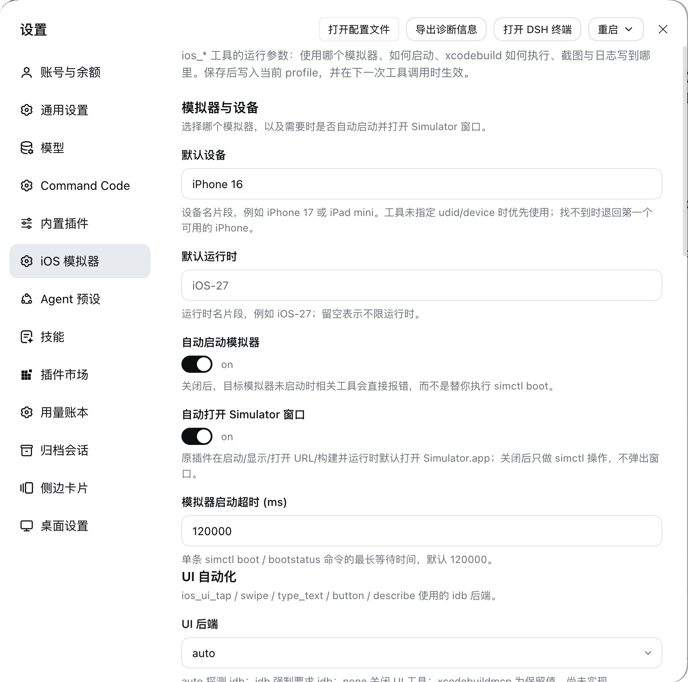
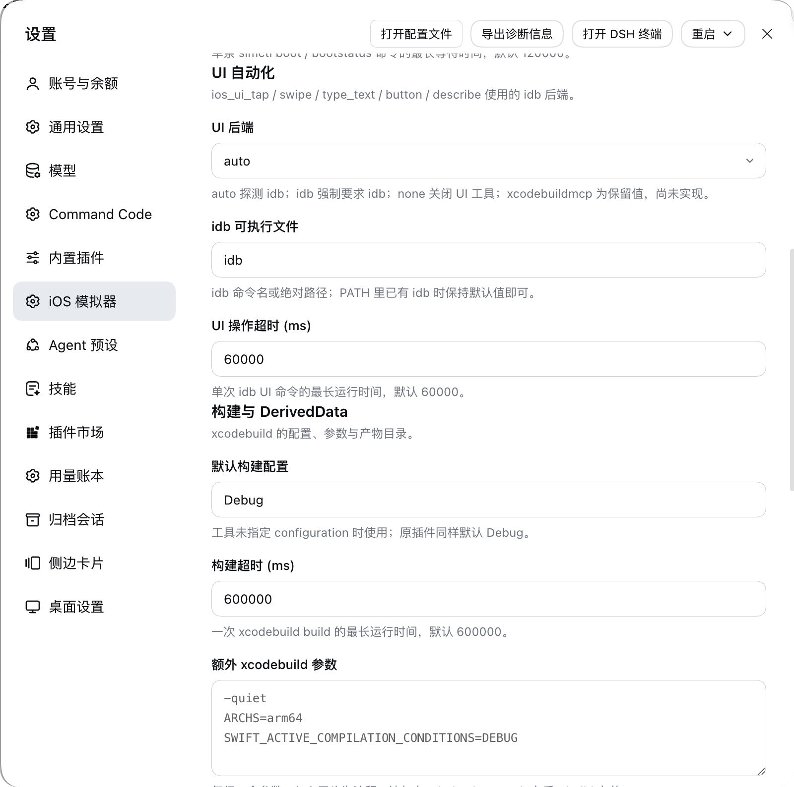
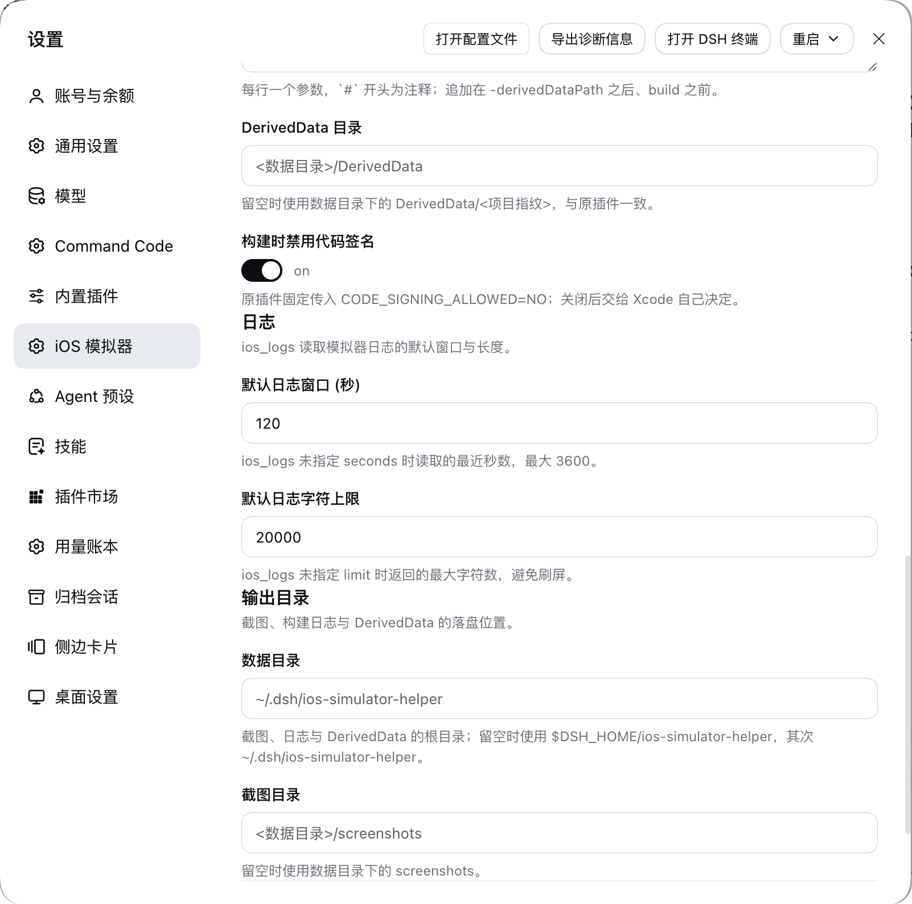
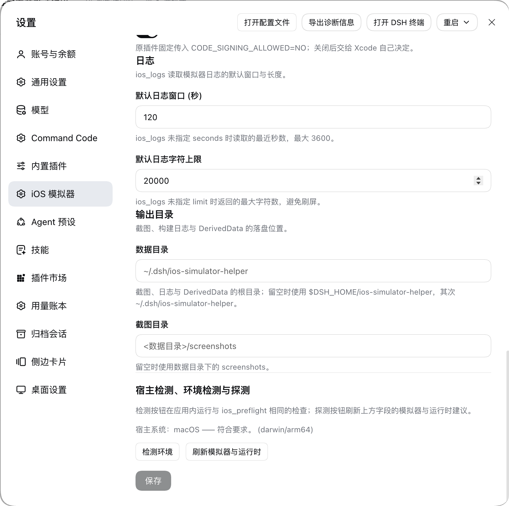

# dsh-ios-simulator-helper

[English](README.md) | [简体中文](README.zh-CN.md)

A DeepSeek Harness (DSH) native port of the official ZCode `ios-simulator@0.1.0` plugin: all 20 original MCP tools preserved as native DSH tools, plus a full **settings page** (Settings → iOS Simulator) that edits the simulator parameters in-app instead of through environment variables.

- Tool and argument names are identical to the original, so workflows written for the `ios_simulator` MCP server keep working; one tool is added — `ios_shutdown_simulator`, because the original could boot a simulator but never stop one.
- 17 settings fields in 5 groups, all live-editable; an empty field falls back to the original plugin's `IOS_SIM_*` variable, then to the built-in default.
- The settings page detects the host system and, **on a non-macOS host, states that this plugin only supports macOS**; every `ios_*` tool refuses in one clear sentence instead of failing with `spawn xcrun ENOENT`.

## Contents

- [Requirements](#requirements)
- [Install](#install)
- [Settings page](#settings-page)
- [Screenshots](#screenshots)
- [Tools](#tools)
- [Skill and slash command](#skill-and-slash-command)
- [Differences from the original](#differences-from-the-original)
- [Architecture](#architecture)
- [Development and verification](#development-and-verification)
- [Marketplace listing](#marketplace-listing)
- [Known limitations](#known-limitations)
- [License](#license)

## Requirements

| Dependency | Notes |
|---|---|
| macOS | The only supported host. `xcrun simctl`, `xcodebuild` and Simulator.app exist nowhere else. |
| Full Xcode | `xcode-select -p` must point at `Xcode.app/Contents/Developer`; Command Line Tools alone are not enough. |
| An iOS Simulator runtime | At least one iOS/iPadOS runtime installed from Xcode → Settings → Platforms. |
| Node.js ≥ 22 | The DSH host runtime. |
| `idb` (optional) | Needed only by the `ios_ui_*` tools. Without it, build/run/screenshot/logs are unaffected. |

`ios_preflight` checks every item above and prints a fix for each failure; the settings page's "Run diagnostic" button runs the same checks.

## Install

### 1. Install dependencies

The package ships source plus a hand-written client bundle; the runtime dependencies come from the DSH profile.

```bash
cd /path/to/dsh-ios-simulator-helper
pnpm install
```

`@deepseek-ai/schemastery`, `@deepseek-ai/dsh-tools` and `@deepseek-ai/cordis` are **peer dependencies**: the harness ships all three, so the plugin declares the versions it is built against instead of pulling in a second copy. DSH's compatibility gate compares the `@deepseek-ai/dsh*` ranges in `peerDependencies` against the running version and refuses to install on a mismatch. The package has no runtime dependencies of its own.

### 2. Install into a profile

**DSH Desktop (local GUI)**: the `desktop` profile is owned by the Electron app. Add this directory through the app's **plugin manager** (install from a local path).

**CLI / any other profile**:

```bash
dsh plugin --profile <profile> add /absolute/path/to/dsh-ios-simulator-helper
```

`package.json` declares `dsh.bundle.patch`, so DSH's reconcile step appends this package to `dsh.profile.bundles`, profile boot merges `cordis.patch.yml`, and exactly one host row is mounted.

**Manual install** (no CLI): add the package as a `file:` dependency in the profile and append its name to `dsh.profile.bundles`:

```jsonc
// ~/.dsh/profiles/<profile>/package.json
{
  "dependencies": {
    "dsh-ios-simulator-helper": "file:/absolute/path/to/dsh-ios-simulator-helper"
  },
  "dsh": {
    "profile": {
      "bundles": ["@deepseek-ai/dsh-base", "…", "dsh-ios-simulator-helper"]
    }
  }
}
```

```bash
cd ~/.dsh/profiles/<profile> && pnpm install
```

Do **not** also add the row to the profile's own `cordis.patch.yml`: mounting the package twice registers the same tool names twice and fails at the loader. Use one channel only.

### 3. Open the settings page

After a reload or restart, open **Settings → iOS Simulator**. The page only appears while the host half actually serves this plugin's settings namespace; otherwise it leaves no trace.

## Settings page

The settings namespace equals the profile patch row id equals `ios-simulator-helper` (also `dsh.name`). The page reads and writes through `ctx.configForms`, so staged edits, dirty detection, inline validation, optimistic concurrency (revisions) and "overridden / reset to default" all come from the harness.

| Group | Field | Type | Default | Legacy env fallback | Notes |
|---|---|---|---|---|---|
| Simulator and device | `defaultDevice` | text (suggestions from this machine) | `iPhone 16` | `IOS_SIM_DEFAULT_DEVICE` | Device-name fragment used when a tool names no `udid`/`device`; falls back to the first available iPhone on a miss. |
| | `defaultRuntime` | text (suggestions from installed runtimes) | empty | `IOS_SIM_DEFAULT_RUNTIME` | Runtime fragment such as `iOS-27`; empty matches any. A **preference, not a requirement**: a stale value widens the pool instead of erroring. |
| | `autoBootSimulator` | switch | on | `IOS_SIM_AUTO_BOOT` | When off, tools fail instead of running `simctl boot` for a stopped target. |
| | `autoOpenSimulator` | switch | on | `IOS_SIM_AUTO_OPEN` | Matches the original by opening the Simulator window (boot / show / open URL / build and run); off keeps everything headless. |
| | `bootTimeoutMs` | integer | `120000` | `IOS_SIM_BOOT_TIMEOUT_MS` | Longest wait for one `simctl boot` / `bootstatus`. |
| UI automation | `uiBackend` | select | `auto` | `IOS_SIM_UI_BACKEND` | `auto` probes for `idb`; `idb` requires it; `none` disables the UI tools; `xcodebuildmcp` is reserved. |
| | `idbBinary` | text | `idb` | `IOS_SIM_IDB_BINARY` | Command name or absolute path of `idb`. |
| | `uiTimeoutMs` | integer | `60000` | `IOS_SIM_UI_TIMEOUT_MS` | Longest runtime of one `idb` UI command. |
| Build and DerivedData | `defaultConfiguration` | text | `Debug` | `IOS_SIM_CONFIGURATION` | Used when a tool names no `configuration`. |
| | `buildTimeoutMs` | integer | `600000` | `IOS_SIM_BUILD_TIMEOUT_MS` | Longest runtime of one `xcodebuild build`. |
| | `extraBuildArgs` | multiline | empty | `IOS_SIM_EXTRA_BUILD_ARGS` | One argument per line, `#` starts a comment; inserted after `-derivedDataPath` and before `build`. |
| | `derivedDataDir` | text | empty | `IOS_SIM_DERIVED_DATA_DIR` | Empty uses `<data dir>/DerivedData/<project fingerprint>`. |
| | `disableCodeSigning` | switch | on | `IOS_SIM_DISABLE_CODE_SIGNING` | The original always passed `CODE_SIGNING_ALLOWED=NO`; off lets Xcode decide. |
| Logs | `logSeconds` | integer | `120` | `IOS_SIM_LOG_SECONDS` | Recent seconds `ios_logs` reads when the call names no window; capped at 3600. |
| | `logLimit` | integer | `20000` | `IOS_SIM_LOG_LIMIT` | Largest rendered log `ios_logs` returns when the call names no limit. |
| Output directories | `dataDir` | text | empty | `IOS_SIM_PLUGIN_DATA` | Root for screenshots, build logs and DerivedData; empty uses `$DSH_HOME/ios-simulator-helper`, then `~/.dsh/ios-simulator-helper`. |
| | `screenshotDir` | text | empty | `IOS_SIM_SCREENSHOT_DIR` | Empty uses `<data dir>/screenshots`. |

Below the form sit the host check and three buttons:

- **Host system** — decided twice: synchronously from the browser's own platform string (so a non-macOS browser sees the notice on first paint, before any request), then authoritatively from the host half's `GET /api/ios-simulator-helper/host`. The host wins on a conflict. When the host is unsupported (or the browser is, and the host is unknown), a red notice titled **"This plugin only supports macOS"** appears above the form and names the detected platform.
- **Run diagnostic** → `GET /api/ios-simulator-helper/status`, the same checks `ios_preflight` runs, listed one by one with status, detail and fix.
- **Refresh simulators and runtimes** → `GET /api/ios-simulator-helper/inventory`, which discovers the Xcode path and version, the macOS version, simulators, runtimes and the resolved default target to fill the fields' suggestion lists.

### Legacy configuration

The original plugin's `userConfig` (`default_device`, `ui_backend`) and its environment variables `IOS_SIM_DEFAULT_DEVICE`, `IOS_SIM_UI_BACKEND` and `IOS_SIM_PLUGIN_DATA` still work as fallbacks (last column above), so an existing ZCode or CI setup needs no change. The original's `IOS_SIM_PACKAGE_ROOT` only located the plugin for its own MCP launcher; DSH resolves the package path directly and does not need it.

## Screenshots

All four are the live page in DSH Desktop, in the order you scroll it — nothing is mocked up.

**1. Simulator and device** — the fields every `ios_*` call reads:



**2. UI automation and builds** — the `idb` backend and its timeout, then the `xcodebuild` configuration, build timeout and extra arguments:



**3. Logs and output** — the DerivedData directory and code-signing switch, then the `ios_logs` window and character limit, then where screenshots, logs and DerivedData land:



**4. Host check and save** — the macOS verdict and the detected platform, the two detection buttons, and the save button:



`screenshots.json` lists these four files in this order next to `package.json`, which is how a plugin market finds them. `assets/` holds only these curated shots; run output and verification captures stay out of the repository (see `.gitignore`).

## Tools

21 tools: the original 20 with identical names and arguments, plus one addition.

| Tool | Purpose |
|---|---|
| `ios_preflight` | Check the host (macOS), Xcode, `xcodebuild`, `simctl`, runtimes, simulators and the UI backend, and echo the current settings. |
| `ios_list_simulators` | List iOS/iPadOS simulators and installed runtimes. |
| `ios_boot_simulator` | Boot the selected simulator, optionally opening the Simulator window. |
| `ios_show_simulator` | Open Simulator.app, optionally focused on one UDID. |
| `ios_shutdown_simulator` | **Added**: shut the selected simulator down (`simctl shutdown`); already-stopped is a success, not an error. |
| `ios_discover_project` | Find `.xcodeproj`/`.xcworkspace`, schemes and bundle ids. |
| `ios_create_app` | Generate a minimal SwiftUI project (refuses to overwrite generated files by default). |
| `ios_build_app` | Build the iOS Simulator product with `xcodebuild`. |
| `ios_build_and_run` | Build → install → launch → show. |
| `ios_install_app` | Install a `.app` on the selected simulator (absolute paths allowed). |
| `ios_launch_app` | Launch by bundle id. |
| `ios_terminate_app` | Terminate by bundle id. |
| `ios_open_url` | Open a URL in the simulator. |
| `ios_screenshot` | Capture a PNG to disk, and return it as an image when the model accepts image input. |
| `ios_logs` | Read `log show` output, optionally filtered by bundle id. |
| `ios_ui_status` | Report UI-automation availability and the backend the settings selected. |
| `ios_ui_tap` / `ios_ui_swipe` / `ios_ui_type_text` / `ios_ui_button` / `ios_ui_describe` | idb-backed tap / swipe / typing / hardware button / accessibility tree. |

Two behaviours deserve their own note:

- **`ios_screenshot`** always writes the PNG to disk (under `<data dir>/screenshots/` by default) and additionally submits it to the host's attachment service for a canonical image block. When the current model declares no image input, or the deployment stores no attachments, the result degrades to text plus the file path instead of failing the call.
- **Bundle-id resolution in `ios_build_and_run`** (a fix over the original): the original asked `xcodebuild -showBuildSettings` and nothing else. Without `-derivedDataPath` that command prepares the *default* DerivedData directory, fails in a restricted environment, and the original silently returned `undefined` — so a successful build was followed by "bundle id could not be resolved". This plugin resolves in the order *explicit `bundleId` argument → `CFBundleIdentifier` of the `.app` that was just built (read with `plutil`, i.e. the value simctl installs) → `-showBuildSettings` with the same `-derivedDataPath` → identifiers found in `project.pbxproj`*, and reports the winner as `bundleIdSource`.

## Skill and slash command

- **`ios-dev` skill** — shipped in `skills/ios-dev/`, registered by the host half through `ctx.skills.register()` as an embedded skill with the skill directory as its `resourceBase`. Rewritten for DSH: no `mcp__…` prefix, environment configuration points at the settings page, and the macOS precondition plus the "shut the simulator down when you are done" step are spelled out.
- **`/ios-dev [goal]` command** — registered through `ctx.commands.register()`. DSH user commands deliberately never create a model message, so this command does the one thing that is useful without the model: it runs the environment diagnostic and prints the verdict, the failing checks and their fixes. On a non-macOS host the verdict is the "only supports macOS" sentence.

## Differences from the original

| Aspect | Original (ZCode) | This plugin (DSH) |
|---|---|---|
| Tool exposure | stdio MCP server `ios-simulator`; the model sees `mcp__ios_simulator__*` | Native `ctx.tools.register()`; the model sees `ios_*` |
| User configuration | `plugin.json` `userConfig` (2 items), injected as environment variables | Settings page with 17 fields on a schemastery `Config`, all `.volatile()`; the old environment variables remain as fallbacks |
| Host check | `process.platform` read once, inside `ios_preflight` | Centralised `requireMacOS()`: one sentence per tool, plus the settings page's synchronous and authoritative verdicts |
| Working directory | `process.cwd()` | `exec.agent.session.header.cwd` (the session workspace) |
| Data directory | `IOS_SIM_PLUGIN_DATA` / temp | `$DSH_HOME/ios-simulator-helper`, configurable on the settings page |
| Path safety | `inside(cwd, path)` refuses escapes | Same semantics, split into read-only paths (an absolute `.app` is fine) and write targets (must stay inside the session workspace) |
| Screenshot result | MCP image content (base64) | An image block built from a host attachment reference, degraded to text plus a disk path on refusal |
| Result normalisation | Providers return objects containing `undefined` | Every tool result passes through `toLosslessJson()` (the registry rejects `undefined`) |
| Slash command | Injects a prompt into the model's conversation | Runs the diagnostic and prints the verdict |
| Process invocation | `node:child_process` spawn | Unchanged |

Keeping direct spawns is a deliberate trade-off: `xcodebuild`, `simctl` and `idb` then behave byte-for-byte as they did in the original. The cost is bypassing DSH's subprocess seam — no unified process management, environment scrubbing or shutdown-time termination. Every external call here has an explicit timeout and a `SIGTERM`, and no credential environment variable is read or forwarded.

## Architecture

```
dsh-ios-simulator-helper/
├── package.json            # dsh.bundle.patch, dsh.client, peer dependencies (compatibility gate)
├── cordis.patch.yml        # - insert: [{ id: ios-simulator-helper, name: 'dsh-ios-simulator-helper' }]
├── ios.svg                 # plugin icon: iOS wordmark in its original colour, inverted in dark mode
├── README.md               # this file (English, primary)
├── README.zh-CN.md         # Simplified Chinese edition
├── lib/
│   ├── index.js            # host half: tools, skill, command, three Fetch routes, settings policy
│   ├── client.js           # browser half: hand-written __ModuleLoader__ bundle, settings page + host check
│   ├── settings.js         # field declarations, schemastery Config (all .volatile()), live reads
│   ├── runtime.js          # per-call runtime (session cwd + live settings + platform → data dirs)
│   ├── tools/index.js      # 21 defineTool definitions, argument/result schemas, image admission
│   ├── providers/          # ported file by file from the original, now taking the runtime explicitly
│   └── util/               # process execution, paths, content blocks
├── skills/ios-dev/         # SKILL.md
├── scripts/                # check-bundle.mjs (consistency gate), verify-mount.mjs, smoke.mjs, link-dsh-deps.mjs
└── test/                   # node:test unit and integration tests
```

Three constraints shaped the layout:

1. **The settings namespace has exactly one source of truth**: the profile patch row id. The `id` in `cordis.patch.yml`, `SETTINGS_NAMESPACE` in `lib/settings.js` and the literal in `lib/client.js` must agree; `scripts/check-bundle.mjs` verifies them, the field-table drift between the two halves, the three routes, and that the macOS logic is still in place.
2. **A browser bundle cannot import a host module** (the client purity gate forbids cross-plugin value imports), so the field table is written twice and kept honest by that gate; the bundle may only `require` the shell's nine static modules (React, Cordis, `dsh-client-store`, `dsh-client-ui-slots`, `dsh-client-ui-primitives`, `dsh-client-ui-dockkit`, …).
3. **The platform check is centralised**: `hostInfo()` / `requireMacOS()` in `lib/providers/host.js` are the only places that read platform semantics, and the platform is an injectable parameter, so the non-macOS branch is testable on a Mac.

## Development and verification

```bash
pnpm install                  # schemastery + react/react-dom (tests only)
pnpm test                     # 80 tests, no Xcode and no simulator required
pnpm run check                # tests + host/client consistency gate + real Cordis mount
pnpm run verify:mount         # real Cordis Context + real ToolRuntime registry
pnpm run smoke                # read-only probes on the real machine
pnpm run smoke:simulator      # generated project → build → install/launch → screenshot → logs → terminate → shutdown
pnpm run link:dsh-deps        # offline development: symlink the local DSH @deepseek-ai packages
```

`smoke:simulator` accepts `--device <fragment>`, `--data-dir <path>`, `--keep` and `--no-macros`:

- The data directory defaults to the generated project, so the run also completes from a restricted (sandboxed) shell, and the cleanup shuts down **only a simulator this run booted** — never one you were already using.
- `--no-macros` replaces the generated `ContentView.swift` with a macro-free variant. The original template's `@State` / `#Preview` need `swift-plugin-server`, whose macro expansion runs under `sandbox-exec`; **a caller that is itself sandboxed cannot start that nested sandbox** and the compile fails with `sandbox-exec: sandbox_apply: Operation not permitted` — which has nothing to do with this plugin (the same command line fails for the original). The flag exists so the rest of the chain — build orchestration, product discovery, install, launch, screenshot, logs, terminate, shutdown — stays verifiable from such a shell.

### Four verification layers

| Layer | Command | What it proves |
|---|---|---|
| Unit / parsers | `pnpm test` | Client-bundle loading contract and static-module limits, manifest and patch contract, settings projection (live volatile reads, environment fallbacks, out-of-range fallbacks, boolean spellings), and the ported parsers (`simctl list` devices and runtimes, UDID validation, selection order, bundle-id sources, `plutil`, path boundaries, log clamping, lossless-JSON normalisation) |
| Settings-page render | `pnpm test` (`client-render.test.js`) | The whole page rendered with real React and `react-dom/server` in four host scenarios (macOS, Linux, Windows, undetectable): every group, field and dictionary key present, controlled inputs carrying real values, switches and selects in the right state, **the "only supports macOS" notice shown on non-macOS and absent on macOS**, the notice naming the detected platform, and no unresolved dictionary key |
| Consistency gate | `scripts/check-bundle.mjs` | Bundle id = package name, namespace = patch row id, the two field tables agreeing key by key and option by option, the three routes present on both sides, the macOS verdict and notice keys still in place, and the bundle still a classic script |
| Real host mount | `scripts/verify-mount.mjs` | Mounting on a **real** Cordis `Context` and the **real** `ToolRuntime`: 21 tools registered, read-only tools dispatched through the registry and validated against their schemas, malformed arguments refused by the registry, unknown tool names unresolvable, all 17 settings fields volatile, and every tool unregistered after dispose |

`smoke` covers what only a real machine can prove: Xcode discovery, actual `simctl` calls, whether the generated project compiles, product discovery and bundle-id resolution, and install / launch / screenshot / logs / terminate / shutdown.

## Marketplace listing

This repository is shaped for the [awesome-dsh-plugin](https://github.com/awesome-dsh-plugin/awesome-dsh-plugin) list and its [contributing guide](https://github.com/awesome-dsh-plugin/awesome-dsh-plugin/blob/main/contributing.md). What that guide asks for, and where it lives here:

| Requirement | Where it is satisfied |
|---|---|
| A `dsh.bundle` manifest in `package.json` — the thing that makes `dsh plugin add` work | `dsh.bundle.patch` → `./cordis.patch.yml`; asserted by `test/manifest.test.js` |
| A `cordis.patch.yml` next to `package.json` that mounts the plugin | `cordis.patch.yml`, one `insert` row whose id is the settings namespace |
| Real, working code rather than a placeholder | `lib/` (host half, client half, 21 tools), `test/`, `scripts/` |
| Official `@deepseek-ai/*` packages declared as `peerDependencies`, not `dependencies` | `package.json` — the package has **no runtime dependencies** |
| A peer range that does not silently exclude prerelease harness builds | every range that names a prerelease also names its next tuple: `^0.2.0-rc.2 \|\| ^0.2.1-alpha.1` |
| 1-8 screenshots declared in this repository | `screenshots.json` → `assets/`, with the `1-8`, in-repo, no-`..` rules asserted by `test/manifest.test.js` |
| `repository`, `homepage` and `bugs` pointing at the listed repository | `package.json`, asserted by `test/manifest.test.js` |

The submission itself is a single file in the list repository — `data/plugins/zhz8888__dsh-ios-simulator-helper.yml`, with `url: https://github.com/zhz8888/dsh-ios-simulator-helper`, `name: zhz8888/dsh-ios-simulator-helper` and a `description.en` that states only what the code does. Category `dev`: the plugin builds, runs and inspects iOS apps from the harness.

Three things no repository can do for itself, and the only ones left:

1. **Push this repository to `https://github.com/zhz8888/dsh-ios-simulator-helper`.** The list's CI fetches `package.json` from that exact URL, which is why `repository`, `homepage` and `bugs` here already name it. If the repository ends up under another owner or name, change those three fields (and the test that pins them) first.
2. **Add the `dsh-plugin` topic** to the GitHub repository.
3. **Wait a day.** The CI rejects repositories younger than 24 hours, so the pull request cannot be opened the same day the repository is created.

Publishing to npm is optional and changes nothing about listing; if you do publish, the package's `repository` field already points back here, which is what links the two.

## Known limitations

- **macOS only.** On any other host `ios_preflight` fails the `Host OS (macOS)` check, skips the remaining probes instead of producing meaningless spawn failures, and every `ios_*` tool refuses; the settings page keeps the notice at the top.
- `ios_ui_*` needs `idb`; `ios_ui_status` explains what is missing. `xcodebuildmcp` is only a reserved value (matching the original's `reservedBackends`) and is not implemented.
- The original's `ios_build_and_run` always opened the Simulator window; here that is the `autoOpenSimulator` setting (on by default, so behaviour matches). `ios_build_app` and `ios_screenshot` still do not open windows, as in the original.
- `ios_logs` reads `log show` (no live stream), with a configurable and clamped window and length.
- Swift-macro projects cannot be compiled when the caller is itself sandboxed (see `--no-macros`); DSH host-half code runs outside the bash sandbox, so normal use is unaffected.
- The generated project template is byte-for-byte the original's (an Xcode 14-compatible `project.pbxproj`, `objectVersion = 56`) and does not track newer Xcode templates.
- **The settings page has been eyeballed once, in DSH Desktop**: the package was installed into the `desktop` profile from a local path, the page opened at Settings → iOS Simulator, and the four shots in `assets/` are that session, top to bottom. Dark theme, narrow-width wrapping and the non-macOS notice are covered by the render tests, not by eye.
- `@deepseek-ai/dsh-client-ui-primitives` is a browser bundler input (`*.module.css`, `simple-icons`, `zustand/vanilla`) that plain Node cannot import, so the render tests double that package; React itself and `react-dom/server` are real.
- No credential handling: the plugin never reads or forwards key/token/secret environment variables.

## License

[MIT](LICENSE), copyright (c) 2026 zhz8888. Tool definitions, provider logic and the generated SwiftUI project template are ported from the ZCode official `ios-simulator` plugin, distributed under the MIT License by Z.ai; the template sources are kept verbatim. See the attribution at the end of [LICENSE](LICENSE).
